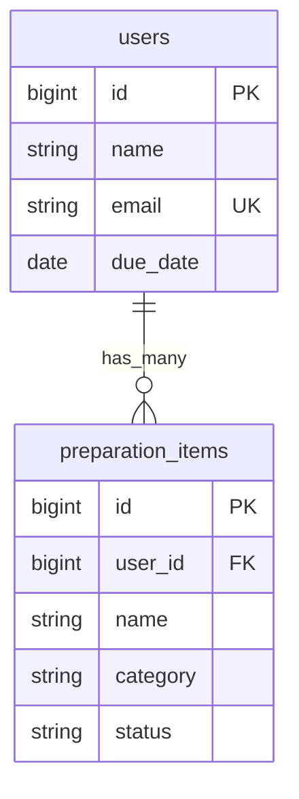
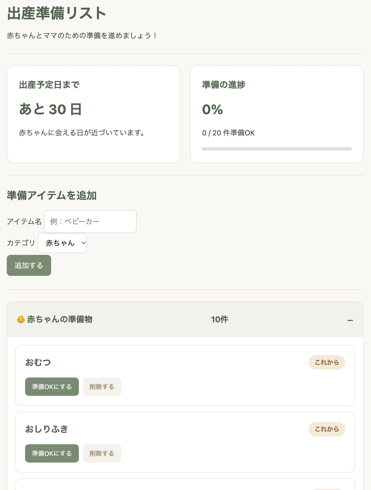

# baby_prep 🍼

出産準備に必要なアイテムを管理するWebアプリケーションです。

## アプリの概要

出産を控えた方が、赤ちゃんとママに必要な準備アイテムを一覧で管理できるアプリです。

準備状況を記録し、まだ準備できていないものをひと目で確認することで、出産に向けた準備をスムーズに進められることを目指しました。

## 開発背景

出産を控えている友人から、入院に向けた準備が大変だという話を聞いたことをきっかけに、出産準備に役立つアプリを作りたいと考えました。

既存の妊娠・出産アプリを調べる中で、アイテムを自由に追加・削除できる機能が少なく、自分に合った準備リストを作りにくいという不便さを感じました。

そこで、必要なアイテムを自由に追加・削除でき、準備状況を管理できるアプリを開発しました。また、準備できていないアイテムをひと目で確認できるようにすることで、買い忘れや準備漏れを防ぎ、出産準備の負担を減らすことを目指しました。

## 主な機能

* ユーザー登録・ログイン・ログアウト
* ユーザーごとの出産準備リスト管理
* 出産予定日までの日数表示
* 準備状況に応じた進捗率の表示
* 赤ちゃん・ママのカテゴリー別アイテム表示
* ユーザー登録時の初期準備アイテム自動作成
* 準備アイテムの追加・削除
* 準備状況の変更（「準備OK」「これから」）
* 未準備アイテムの一覧表示
* 入力値のバリデーション
* 日本語のバリデーションエラーメッセージ

## 使用技術

* Ruby
* Ruby on Rails 7.2.3
* SQLite3
* Devise（ユーザー認証）
* Minitest（自動テスト）
* HTML / CSS

## ER図

## 画面イメージ

## 今後の改善予定

* ユーザー名・出産予定日の編集機能
* 準備アイテムの編集機能
* UI・デザインの改善
